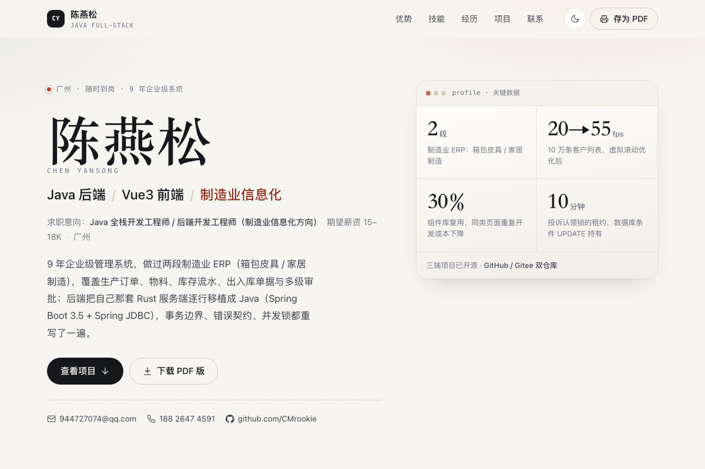

# 陈燕松 · 线上简历

一个静态生成的个人简历站点：**Nuxt 4 + Vue 3**，`nuxt generate` 出纯静态文件，由 **GitHub Actions** 自动发布到 **GitHub Pages**。



- 线上地址：<https://cmrookie.github.io/personal-web/>
- 单页结构：个人优势 / 专业技能 / 工作经历 / 项目经历 / 联系方式
- 自带**深色模式**、滚动动效、响应式，以及一套 **A4 打印样式** —— 点页面右上角「存为 PDF」就能导出 PDF 版简历

---

## 本地开发

```bash
npm install
npm run dev          # http://localhost:3000
```

## 构建与预览

```bash
npm run generate       # 生成到 .output/public（默认 baseURL = /personal-web/）
npm run generate:pages  # 同上，显式带上 baseURL，CI 之外跑更保险
PREVIEW_BASE=/personal-web/ npm run preview:dist
```

`preview:dist` 会把 `.output/public` **按项目站点的子路径方式**挂载到
`http://localhost:4173/personal-web/`，用来提前发现 baseURL 配错导致的 404 / 白屏。

> **为什么要有 baseURL**：项目站点地址是 `https://<用户名>.github.io/<仓库名>/`，
> 资源必须从子路径加载。CI 里由 `${{ github.event.repository.name }}` 自动拼出来。

---

## 部署（GitHub Pages）

发布走 `.github/workflows/deploy.yml`：推 `main` → Actions 里 `npm ci` + `npm run generate` → 产物发布到 Pages。

### 一次性准备

仓库 **Settings → Pages → Build and deployment → Source** 选 **「GitHub Actions」**。

> 必须选这个。如果选「Deploy from a branch」，Actions 的发布任务会报
> `Get Pages site failed`，站点也起不来。

### 之后每次发布

```bash
git push origin main
```

Actions 自动构建并发布，几十秒后 <https://cmrookie.github.io/personal-web/> 更新。
也可以在 Actions 页面手动 `Run workflow`。

### 手动兜底（不想等 CI，或 CI 不可用时）

```bash
npm run deploy:branch        # 本地构建 → 推到 gh-pages 分支
```

这条路线要求 Pages 的 Source 改成 **「Deploy from a branch」→ `gh-pages` / root**，
两种 Source 二选一，不要同时用。

换托管平台只改环境变量（脚本默认推 GitHub）：

```bash
GIT_REMOTE=git@gitee.com:rookie_c/personal-web.git \
GIT_BRANCH=pages GIT_BASE=/personal-web/ \
GIT_SITE_URL=https://rookie_c.gitee.io/personal-web/ \
npm run deploy:branch
```

---

## 改内容

**每个岗位一份完整内容，中英各一套**：

```
app/data/
  stack.zh.ts / stack.en.ts # 全栈（制造与工艺，/ 与 /java 共用）
  fe.zh.ts   / fe.en.ts     # 前端（电商 / AI 辅助开发）
  shared.zh.ts / shared.en.ts   # 两个岗位共用的工作经历与教育背景
  ui.zh.ts   / ui.en.ts     # 界面文案（按钮、栏目标题、aria）
```

`resume.ts` 把「语言 × 岗位」解析成 reactive 对象，切换时原地替换，
组件不需要感知当前是哪一套。

| 想改什么 | 改哪里 |
| --- | --- |
| 手机号 / 邮箱 / 求职意向 | `profile` |
| 首页基本信息（年限 / 学历 / 薪资 / 到岗） | `basicInfo` |
| 个人优势 | `strengths` |
| 技能矩阵 | `skillGroups`（`core` 是加粗的主力栈） |
| 工作经历 | `shared.zh.ts` 的 `jobs`（`kind: 'note'` 渲染成灰色、无技术栈） |
| 项目卡片 | `projects`（`results` 可省，省了就不渲染「结果」块） |
| 站点标题 / 描述 / 更新时间 | `site` |

样式在 `app/assets/css/main.css`：改 `:root` 里的 CSS 变量就能换配色，
深色模式在 `:root[data-theme="dark"]`。

### 岗位子路由

同一个站点按**投递岗位**准备了三套内容：

| 路径 | 岗位 | 内容来源 |
| --- | --- | --- |
| `/` | 全栈开发工程师（制造与工艺） | `陈燕松-Java全栈工程师-制造与工艺板块.md` |
| `/java/` | Java 全栈开发工程师 | 同上，只换定位文案 |
| `/frontend/` | 前端开发工程师（电商 / AI 辅助开发） | `陈燕松-前端开发工程师-AI电商.md` |

`/` 与 `/java/` **内容完全相同**，只在标题、求职意向、首屏副标、SEO 描述上区分
—— `asJavaPositioning()` 在默认包上改写这几处，不复制整份内容。
`/frontend/` 是独立的另一份内容（优势、技能、项目都不一样）。

`/fullstack/` 曾经存在，现在是一张 meta refresh 的跳转页。

滚动后 header 里那行副标也会跟着变：`/` 是 `FULL-STACK ENGINEER`，
`/java/` 是 `JAVA FULL-STACK ENGINEER`。

**页面上没有任何入口指向这些子路由** —— 导航、页脚、sitemap 都没有，
只能手输地址访问（发给不同 HR 时各发一条链接即可）。未登记的路径会落到
Nuxt 的 404。

岗位在 `app/data/variants.ts` 里登记，想加就在里面加一项，再到
`nuxt.config.ts` 的 `nitro.prerender.routes` 里补上路径 —— 因为页面上
没有链接，`crawlLinks` 发现不了它们。

> `prerender.concurrency` 必须是 `1`：内容 store 是模块级单例，
> 并发预渲染会让不同岗位的数据互相串台。

### 两个开关

| 环境变量 | 默认 | 作用 |
| --- | --- | --- |
| `SITE_INDEXABLE` | `0`（不收录） | 设为 `1` 才允许搜索引擎收录。**默认 noindex**，因为页面上有手机号和邮箱，不想被爬虫抓去做骚扰电话/垃圾邮件。 |
| `NUXT_PUBLIC_SITE_URL` | CI 里按仓库名推导 | 生成 canonical / og:url |

两个都在 `.github/workflows/deploy.yml` 的 `env` 里改。
深色模式默认跟随系统；也可以用 `?theme=dark` / `?theme=light` 强制指定（分享链接时有用）。

---

## 目录结构

```
.github/workflows/deploy.yml  # CI：构建 + 发布到 GitHub Pages
app/
  app.vue                     # 页面组装、SEO、滚动动效
  data/stack.zh.ts            # ★ 全栈（中）
  data/stack.en.ts            # ★ 全栈（英）
  data/fe.zh.ts               # ★ 前端电商 / AI 辅助开发（中）
  data/fe.en.ts               # ★ 前端电商 / AI 辅助开发（英）
  data/shared.zh.ts           #   两个岗位共用的工作经历 / 教育
  data/shared.en.ts           #   同上（英）
  data/ui.zh.ts               #   界面文案
  data/ui.en.ts               #   界面文案（英）
  data/resume.ts              # reactive 包装 + 语言 / 岗位切换
  data/variants.ts            # ★ 岗位登记（子路由，含「Java 全栈」改写）
  middleware/variant.global.ts # 进入路由前先把岗位落到 store
  pages/index.vue             # 默认岗位
  pages/[slug].vue            # 岗位子路由（未登记的 404）
  components/                 # 各区块组件
  composables/useTheme.ts     # 深色模式
  assets/css/main.css         # 全部样式 + A4 打印样式
server/routes/robots.txt.ts   # 按 SITE_INDEXABLE 生成 robots
scripts/deploy-branch.sh      # 手动兜底：构建后推到独立分支
scripts/preview.mjs           # 子路径预览静态产物
public/favicon.svg
public/avatar.jpg            # 头像（滚动时缩到 header）
```

## 常见问题

**Actions 报 `Get Pages site failed`** —— Pages 的 Source 没选成「GitHub Actions」。

**页面白屏 / 样式丢失** —— 多半是 baseURL。确认构建时带了 `NUXT_APP_BASE_URL=/personal-web/`，
再用 `npm run preview:dist` 验证一次。

**推了但站点没更新** —— 看 Actions 页面有没有失败的 run；Pages 部署有缓存，等 1 分钟。

**打印出来的 PDF 排版乱** —— 打印样式只在 `@media print` 里，Chrome / Edge 导出最稳；
导出时勾选「背景图形」才能带上浅色底纹。
